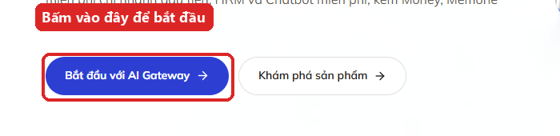
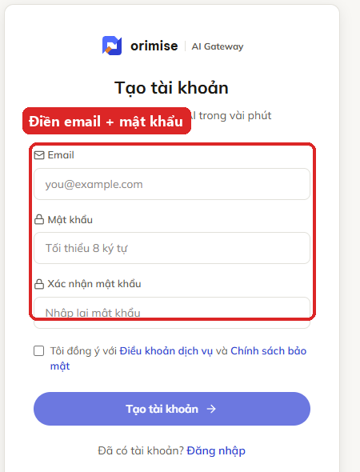
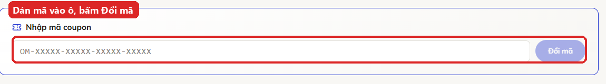
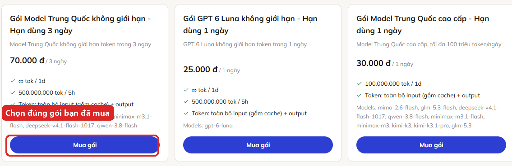
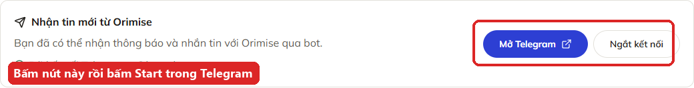

> Gói **Codex theo token** (30M / 50M / 100M / 200M, hạn 1–3 ngày), gói **GPT 6 Luna không giới hạn** và gói **model Trung Quốc** dùng chung một quy trình: nhận mã → nạp credit → chọn gói → tạo API key.

**Base URL dùng cho mọi gói:** `https://api.orimise.com/v1`

---

## Mục lục

1. [Bước 1 — Vào Orimise từ trang chủ](#bước-1--vào-orimise-từ-trang-chủ)
2. [Bước 2 — Tạo tài khoản](#bước-2--tạo-tài-khoản)
3. [Bước 3 — Nạp mã coupon](#bước-3--nạp-mã-coupon)
4. [Bước 4 — Chọn gói](#bước-4--chọn-gói)
5. [Bước 5 — Tạo API key](#bước-5--tạo-api-key)
6. [Bước 6 — Gọi API](#bước-6--gọi-api)
7. [Kết nối Telegram để nhận hỗ trợ](#kết-nối-telegram-để-nhận-hỗ-trợ)
8. [Lưu ý & bảo hành](#lưu-ý--bảo-hành)

---

## Bước 1 — Vào Orimise từ trang chủ

Mở **[orimise.com](https://orimise.com)** và bấm **"Bắt đầu với AI Gateway"** (hoặc nút **"Bắt đầu"** ở góc trên bên phải).



> Đi từ trang chủ để bạn xem được bảng giá và mô tả sản phẩm trước khi vào dashboard.

## Bước 2 — Tạo tài khoản

Tại trang đăng ký, điền **email** và **mật khẩu** (tối thiểu 8 ký tự), tick đồng ý điều khoản rồi bấm **"Tạo tài khoản"**. Sau đó nhập mã OTP gửi về email.



Đã có tài khoản thì bấm **"Đăng nhập"**.

## Bước 3 — Nạp mã coupon

Vào **Thanh toán** trong sidebar trái (hoặc mở `orimise.com/dashboard/billing`).



1. Dán mã coupon nhận được khi mua hàng vào ô **"Nhập mã coupon"** (dạng `OM-XXXXX-XXXXX-XXXXX-XXXXX`).
2. Bấm **"Đổi mã"** — credit cộng ngay vào **Số dư hiện tại**.

## Bước 4 — Chọn gói

Vào **Gói quota** (`orimise.com/dashboard/quota-packages`) → chọn đúng gói bạn đã mua → bấm **"Mua gói"**. Giá gói trừ bằng credit vừa nạp, hạn gói tính từ lúc mua.



Gói hiện có:

| Gói | Giá | Quota |
|---|---|---|
| Codex 30M token — 1 ngày | 25.000đ | 30.000.000 token / 1d |
| Codex 50M token — 1 ngày | 35.000đ | 50.000.000 token / 1d |
| Codex 100M token — 1 ngày | 65.000đ | 100.000.000 token / 1d |
| Codex 100M token — 3 ngày | 85.000đ | 100.000.000 token / 3d |
| Codex 200M token — 1 ngày | 115.000đ | 200.000.000 token / 1d |
| Codex 200M token — 3 ngày | 135.000đ | 200.000.000 token / 3d |
| GPT 6 Luna không giới hạn — 1 ngày | 25.000đ | không giới hạn / 1d |
| Model Trung Quốc không giới hạn — 1 ngày | 30.000đ | không giới hạn / 1d |
| Model Trung Quốc không giới hạn — 3 ngày | 70.000đ | không giới hạn / 3d |
| Model Trung Quốc cao cấp — 1 ngày | 30.000đ | tối đa 100.000.000 token / 1d |

## Bước 5 — Tạo API key

Vào **API Keys** (`orimise.com/dashboard/keys`) → nhập tên key (ví dụ `Codex`) → bấm **"Tạo"** → copy key vừa sinh (dạng `sk-...`).

Base URL: `https://api.orimise.com/v1`

## Bước 6 — Gọi API

```bash
curl https://api.orimise.com/v1/chat/completions \
  -H "Authorization: Bearer sk-..." \
  -H "Content-Type: application/json" \
  -d '{"model":"gpt-6.1-sol","messages":[{"role":"user","content":"Xin chào"}]}'
```

Dùng với Codex CLI, Claude Code, Cursor, Cline, Roo, Continue, VS Code: chỉ cần đổi **Base URL** sang `https://api.orimise.com/v1` và dán API key.

> Hướng dẫn cấu hình chi tiết từng công cụ: mục **Tích hợp CLI** trong dashboard.

## Kết nối Telegram để nhận hỗ trợ

Vào **Cài đặt** (`orimise.com/dashboard/settings`) → mục **"Nhận tin mới từ Orimise"** → bấm **"Kết nối @OrimiseBot"** → **"Mở bot và bấm Start"** trong Telegram (liên kết dùng một lần, hiệu lực 15 phút).



Sau khi kết nối, nhắn thẳng cho **@OrimiseBot** — bot trả lời trong cùng khung chat, kèm lịch sử đơn và số dư của bạn.

## Lưu ý & bảo hành

- Hạn gói tính liên tục theo ngày, **không tạm dừng**.
- Token chưa dùng hết khi hết hạn sẽ không được hoàn.
- Lỗi phát sinh từ hệ thống: hoàn credit cho phần token chưa dùng.
- Không chia sẻ API key; key lộ sẽ bị thu hồi.
- Gói Codex **không bao gồm** model Astra.
